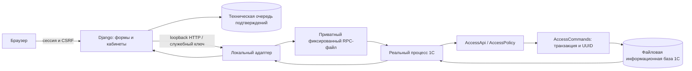

# Архитектура локальной информационной системы

## Границы проекта

Тема — организация пропускного режима на платформе 1С:Предприятие. Пользователь выбрал Python для интерфейса и 1С для предметных данных/правил. Внутренний процесс ООО «ЧРЗ» не обследован; приведённая схема описывает разработанное учебное приложение. Требования индивидуального задания №4 ещё не предоставлены.

## Компоненты и ответственность

| Компонент | Ответственность | Исходники |
| --- | --- | --- |
| Портал | Вход, формы, CSRF, отображение состояния, восстановление неподтверждённой команды | portal/requests.py, workflow.py, commands.py |
| Техническая SQLite | Auth/session и PendingCommand; очередь хранит подготовленные параметры до подтверждения | portal/models.py |
| HTTP-адаптер | Loopback, служебная аутентификация, ограничения размера/маршрута, последовательный вызов платформы | portal/local_gateway.py |
| RPC | Чтение фиксированного файла текущей базы и ответ с UUID вызова | AccessLocalRpc |
| API | Разбор маршрута, области чтения, JSON DTO и безопасные ошибки | AccessApi |
| Политика | Сопоставление actor с единственным действующим PortalUsers и ролью | AccessPolicy |
| Команды | UUID, SHA256, транзакция предметного изменения и ответа | AccessCommands |
| Предметные правила | Создание/решение заявки, выдача/отзыв и движение | AccessRequests, AccessApprovals, AccessPasses |

Каждый предметный результат вычисляет процесс 1С. Python работает с DTO и технической очередью. Изменение 1CD выполняется средствами установленной платформы. `run_local.py` подготавливает техническую базу, запускает портал и его локальный HTTP-адаптер. Однократный `--setup-demo --check` собирает конфигурацию из исходников и создаёт вымышленные данные.

В установленной macOS-сборке доступны клиенты/Конфигуратор; ibsrv/ibcmd/webinst отсутствуют. Выбран локальный файловый адаптер. Собственный нативный HTTP-сервис платформы и её многопользовательская аутентификация остаются отдельным открытым направлением. Назначение 1cv8s как launcher описано в [руководстве платформы, приложение 1.2](https://1c-dn.com/library/tutorials/1c_enterprise_administrator_guide_file_mode_8_3_27/).

## Предметная модель

| Объект 1С | Данные и связи |
| --- | --- |
| Departments | Подразделение |
| Employees | Сотрудник → Departments; признак активности |
| Visitors | Посетитель, организация посетителя |
| Checkpoints | Точка прохода, активность |
| VisitPurposes | Цель посещения |
| PortalUsers | Логин портала, прикладная роль, активность |
| Requests | Посетитель/сотрудник/точка/цель, период, автор, статус и решение |
| Passes | Одна заявка, состояние и положение, автор/время выдачи/отзыва |
| GateEvents | Пропуск/точка/направление/оператор/время; история неизменяема |
| CommandJournal | Технический actor+UUID+SHA256+ответ для точного повтора |

Типизированные ссылки определены в one_c/schema.json и XML. Идентификаторы метаданных воспроизводимы, генератор сохраняет UUID. Служебные объекты очереди/журнала учитываются отдельно от предметных сущностей.

## Переходы и транзакции

`submitted → approved/rejected/cancelled`. Заявитель отменяет свою ожидающую заявку, согласующий/admin принимает решение, собственное согласование запрещено. Реквизиты отправленной заявки сохраняются. Пропуск выдаёт guard/admin для согласованной заявки; отзыв необратим. Вход проверяет срок, точку, активность и положение снаружи. Выход из положения внутри допускается после отзыва/истечения срока. Правила проекта описаны в PASS_RULES.md.

Запись проходит AccessCommands. Сначала блокируются прикладные права, затем журнал команд и соответствующий предметный объект. Журнал сохраняет результат в той же транзакции. Идентичный actor/UUID/тело возвращает прежний ответ, изменённое тело даёт409. Политика проверяется до возврата повтора. Методы AccessPasses требуют активной транзакции команды; ожидаемые отказы проверяются до записи объекта, объектные модули повторяют проверки.

В SQLite PendingCommand уникален по владельцу/контексту. Параметры закрепляются атомарным UPDATE перед отправкой; изменённый повтор блокируется. Подтверждённый результат/отказ освобождает запись, неизвестный сохраняет её между входами. Удаление использует также UUID: поздний ответ прежней команды сохраняет новую подготовленную команду того же контекста.

## Время и границы доверия

На границе используются ISO8601 с часовым поясом и точностью до секунды. Внутри обмена UTC; обычные формы показывают Тбилиси, периодный отчёт и печатный лист явно подписаныUTC. Смещение разбирает ДатаUTC: прямое XML-преобразование в установленной версии не сохранило смещение, что обнаружила реальная проверка roundtrip.

Браузер отправляет данные формы с CSRF. Actor формирует сервер по текущему аккаунту. HTTP-адаптер требует отдельный случайный ключ и отклоняет чужие Origin/Host. Ключ хранится локально с правами0600. RPC-каталог закрыт0700; серверная точка без параметров выбирает путь по текущей файловой базе. Ответ проверяется по UUID. Бизнес-модули непривилегированные, прямой ServerCall отключён; отдельные точки самопроверки/RPC ограничены.

Рабочая граница — локальная учебная файловая база и один последовательный вызов. Прикладные роли портала не являются доказательством настроенных нативных многопользовательских прав платформы.

## Проверенная поставка и развитие

Реальная1С: CheckConfig без ошибок и25серверных утверждений сrollback. В отдельнойqa-базе прошли27настоящихHTTP-проверок, включая карточки решения/отзыва, приватностьUUID, полный периодный отчёт и создание посетителя с единственным повтором. Портал имеет38тестов. Подробности — reports/1c-visitors-v1.json.

Прямые карточки заявок/пропусков не зависят от оперативного списка последних100. Формы команд используютUUID, поэтому рост истории не лишает пользователя известной записи и повтора неизвестного результата. Пустые даты передаются какНеопределено→JSONnull; неподдерживаемый тип сериализации даёт контролируемый500 с приватной диагностикой.

Отчёт1–31деньUTC выбирает полный ограниченный период до1000событий и отклоняет1001-ю запись. Итоги рассчитывает1С; Python проверяет диапазон/структуру/согласованность. CSV защищает формулы. Разность входов/выходов окна не выдаётся за присутствие. Имена относятся к текущим справочникам. Печатный лист — информационный снимок со сроком/состоянием/отзывом, не самостоятельная команда допуска.

Посетитель создаётся администратором через тот же атомарный журнал. Предел500 проверяется под блокировкой каталога. В форме заявки организация и короткийID различают одинаковыеФИО. Остальные справочники и прикладные профили требуют дальнейшего обслуживания; нативная многопользовательская аутентификация не заявляется готовой.

Новая чистая установка изGit в отдельномvenv, пустой техническойSQLite и пустой1С воспроизводит основной цикл настоящимChrome157 четырьмя ролями, включая нового посетителя, карточки, печать, период/CSV и ролевой403. Актуальная проверка — reports/local-install-v2.json и local-visual-v2. Параметры/ограничения повторения — ACCEPTANCE.md.

Следующее развитие: обслуживание остальных справочников/профилей, поиск/пагинация, дополнительные нативные границы и безопасное ускорение локального обмена. Норма50 содержательных коммитов и неизвестное индивидуальное задание4 проверяются отдельно от функционального результата.
